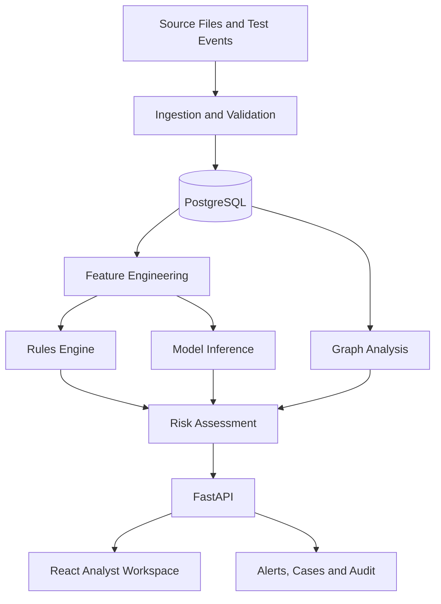

# TxnVeyra Architecture

## Architecture style

TxnVeyra uses a modular-monolith approach. The frontend is a separate React application; the backend is a FastAPI application with explicit domain boundaries. Independently deployed services will be considered only when measured requirements justify their operational cost.

## Technology decisions

- React, TypeScript and Vite for the web client
- FastAPI and Pydantic for the API
- PostgreSQL, SQLAlchemy and Alembic for persistence
- Pandas for initial tabular ingestion
- scikit-learn, XGBoost and LightGBM for future model evaluation
- SHAP for future model explanations, subject to validation
- NetworkX for initial graph analysis
- MLflow for experiment tracking
- Pytest, HTTPX, Vitest and React Testing Library for testing
- Docker Compose for local development

## Logical flow

## Backend boundaries

- Transactions: source ingestion, search and transaction details.
- Alerts: risk assessments, alert prioritization and alert state.
- Investigations: cases, assignments, notes and evidence snapshots.
- Entities: entity identity and supported relationship edges.
- Analytics: aggregated metrics and time/geography summaries.
- Users: authentication and authorization.
- Audit: security-sensitive and analyst action history.

Domain logic belongs in services, not route handlers. Routes validate requests and invoke application services. Repositories own persistence.

## Data separation

Each source dataset is stored under its own namespace. Dataset identifiers and labels are not assumed to be interchangeable. Cross-source joins require a documented and verified linkage key.

## Initial implementation boundary

The first implementation provides API health checks, database connectivity, source dataset contracts, CSV ingestion, import-run metadata, source-record persistence, and a frontend shell.

Authentication, risk scoring, graph analysis, case management, and event streaming are separate future stages.
